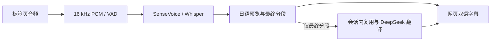

<div align="center">

# Live Translation

**日语语音，本地识别。双语字幕，随视频呈现。**

为 Chrome / Edge 设计的实时字幕扩展，支持中文与英文翻译。<br>
从直播访谈到日常视频，让字幕保留上下文，也留出阅读的时间。

[](LICENSE)
[](extension/manifest.json)

[快速开始](#快速开始) · [本地服务](docs/local-service.md) · [专名词表](docs/asr-domain.md) · [开发文档](docs/development.md)

</div>


## 为观看体验设计

| 能力 | 体验 |
| --- | --- |
| **装扩展即可使用** | 默认由 SenseVoice 在浏览器内识别，无需单独启动本地服务；识别模型下载后缓存复用。 |
| **按句生成译文** | 日语预览实时更新，最终分段才交给 DeepSeek；上一句帮助理解指代和语气，译文只包含当前句。 |
| **留得住的字幕** | 等待翻译时保留日语，译文按长度获得阅读时间。前面长句先退场，后面短句随后退出。 |
| **融入画面的字幕框** | 悬停后显示样式设置与拖动手柄，离开后背景淡化；支持字号、宽度、颜色、阅读速度和减少动态效果。 |
| **更熟悉的专名** | 内置学マス、陽高真白及部分 BanG Dream! / Love Live! 声优、角色、团体和歌曲词表，可切换或关闭。 |
| **减少重复调用** | 会话内译文缓存与进行中请求合并，复用相同上下文中的相同输入；保留 API 用量与耗时统计。 |

识别在本机完成，**翻译需要联网并使用 DeepSeek API Key**，费用由 API 服务方收取。本项目不提供托管翻译服务。

## 快速开始

需要 Chrome / Edge 116 或更新版本，以及一个可用的 DeepSeek API Key。

1. 下载本仓库并解压到固定目录，或执行：

   ```sh
   git clone https://github.com/VivoWalker/Live-Translation.git
   ```

2. 打开 `chrome://extensions` 或 `edge://extensions`，开启「开发者模式」，点击「加载已解压的扩展」，选择仓库中的 **`extension/`** 目录。
3. 打开有日语音频的普通网页，点击扩展图标。选择「浏览器内」，填写 DeepSeek Key、选择译文语言，然后点击「开始字幕」。
4. 首次使用会下载约 **240 MB** 识别模型。加载完成后，声音继续播放，双语字幕显示在网页上。

模型保存在浏览器管理的本地缓存中。每次开始字幕时从缓存读取和校验，识别器初始化后释放模型文件的临时副本。缓存写入失败时，弹窗会给出提示。更新扩展时在原条目点击「重新加载」，并刷新视频页。保持目录及扩展 ID 可继续使用原有模型缓存与设置。

### 调整字幕

在扩展菜单的「字幕」页预览样式，也可悬停视频字幕框打开「字幕设置」。选择均衡、轻透或高对比预设，再按「文字」「底板」「阅读」调整日语和译文的字号、配色、行距、位置与停留时间。扩展内的设置会同步到正在播放的页面，拖动手柄可调整位置。

本地服务页面提供同样的设置、字幕预览和日语样本播放，外观保存在当前浏览器。本地页和扩展各自保存设置。句子积压时，点击「回到实时」跳到最新一句。

### 选择运行方式

| | 浏览器内 · 默认 | 本地服务 · 可选 |
| --- | --- | --- |
| 语音识别 | SenseVoiceSmall int8，WASM | SenseVoice 或实验性 Whisper int8 |
| 翻译 | 扩展直接请求 DeepSeek | Python 服务请求 DeepSeek |
| 安装要求 | 浏览器扩展 | 扩展与 Python 服务；也提供独立演示页 |
| 适合 | 日常观看、希望安装步骤更少 | 希望利用 CPU 多线程、试用 Whisper 或调试 |

本地服务通过 WebSocket 接收音频，需要单独的访问令牌。模型准备、Windows / Linux / macOS 安装及 Whisper 切换见 [本地服务指南](docs/local-service.md)。

## 专名识别

浏览器与 Python 共用五套可独立启用的词库，共 **453 个词条、1,367 种识别写法**。角色名、节目名、歌曲和常见简称在显示日语与发送翻译前完成本地纠错。

| 识别写法 | 规范写法 |
| --- | --- |
| ひたかましろ、日高真白 | 陽高真白 |
| 学馬、がくま水曜日 | 学マス、学マ水曜日 |
| ぽぴぱ、バンドリのラス | ポピパ、バンドリのRAS |
| にじがく、セイハス | ニジガク、せーはす |

在扩展弹窗的「专名词库」中可分别勾选陽高真白、学マス、BanG Dream!、Love Live!、通用声优与动画。选择在下次开始字幕时生效。

词表属于文本纠错，模型权重保持原版。目前没有这些节目的标注音频，尚未量化识别准确率提升。维护方法和误改控制见 [日语领域识别说明](docs/asr-domain.md)。

## 翻译与数据流



- **音频**：浏览器内模式在本机识别；服务模式将 PCM 发送到配置的服务地址，默认 `127.0.0.1`。音频不提交给 DeepSeek 翻译接口。
- **台词**：翻译请求包含当前句与作为上下文的上一句日语，不累计整段会话。日语预览不触发翻译请求；连续长语音仍有 12 秒分段上限。
- **凭据**：浏览器模式的 Key 保存在扩展本地存储；服务模式使用本地配置或环境变量。`config.local.json` 已被 Git 忽略。
- **复用**：译文缓存只存在于当前会话内存，最多 500 条、1 MiB；停止、重启或配置切换后清理。不同上下文不混用译文。

本地缓存和请求合并减少的是实际 API 调用。固定请求前缀不保证 DeepSeek 服务端缓存命中，实际费用取决于输入、输出与服务方计费。请求结构、usage 统计及少量真实 API 对照记录见 [翻译与用量说明](docs/translation.md)。

## 开发与验证

Python 服务建议使用 Python 3.11+；JavaScript 测试需要 Node.js 22+。在虚拟环境中安装依赖后运行：

```sh
python -m pip install -r requirements.txt -r requirements-dev.txt
python -m unittest discover -s tests
node --test tests/*.test.mjs
```

当前版本已通过 **59 项 Python 测试、57 项 JavaScript 测试**，并完成 Chromium 字幕交互和真实 SenseVoice WASM 样本识别。完整安装后的 `tabCapture` 流程仍需浏览器实际交互。

架构、协议、测试工具与验证边界见 [开发指南](docs/development.md)；版本变更见 [CHANGELOG](CHANGELOG.md)。

## 使用边界与排查

- 首次下载识别模型需要访问 Hugging Face / GitHub Releases。模型缓存后可离线识别，DeepSeek 翻译仍需联网。
- 浏览器识别有 CPU 与内存开销。背景音乐、多人重叠、方言及专名可能降低准确率，歌词演唱也不等同于清晰对白。
- DRM 页面可能无法采集有效音频；浏览器内部页面不支持标签页采集。
- 译文会落后于语音分段和网络响应，阅读队列还可能主动延长字幕停留。

| 现象 | 检查方式 |
| --- | --- |
| 每次重开都提示下载模型 | 查看弹窗的缓存保存提示，确认存储可用，并保持原扩展 ID。 |
| 有日文但没有译文 | 检查 DeepSeek Key、网络与 API 额度；失败信息会显示在扩展中。 |
| 本地服务连接失败 | 确认服务已启动、地址正确，并填写服务显示的访问令牌。 |
| 字幕未出现在网页上 | 重新加载扩展后刷新视频页，确认页面有声音且允许采集。 |
| 专名被错误替换 | 关闭专名纠错，或按词表指南收紧相应别名与语境规则。 |

反馈问题时，请附浏览器版本、运行模式、复现步骤及已移除凭据的错误信息：[提交 Issue](https://github.com/VivoWalker/Live-Translation/issues)。

## License

项目原创代码与文档采用 [MIT License](LICENSE)，允许使用、修改和再分发，包括商业用途，须保留许可证及版权声明。

随附的 sherpa-onnx WASM 运行时、下载的识别模型及其他第三方组件保留各自的许可，**不因本项目使用 MIT 而改变**。DeepSeek 等在线服务适用各自的服务条款。组件来源、许可文本及范围见 [第三方声明](THIRD_PARTY_NOTICES.md)。
