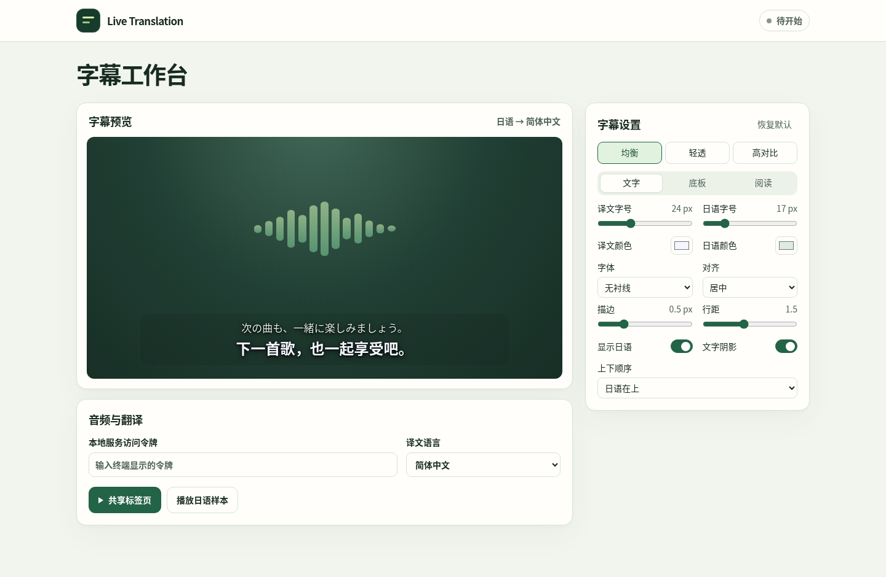

# ja-live-subs

浏览器里看日语视频时的**实时双语字幕**：本机识别日语语音，DeepSeek 翻译，字幕直接叠在网页上。

参考 [VocaLume](https://github.com/clark970417-eng/VocaLume) 的思路做的精简原型，只保留三件事：**日语识别 → 翻译 → 浏览器字幕**。



---

## 1. 两种运行方式

| 模式 | 需要本地程序 | 识别 | 翻译 | 适用 |
| --- | --- | --- | --- | --- |
| **浏览器内（默认）** | 不需要，装扩展即可 | SenseVoiceSmall int8，WASM，跑在扩展的 offscreen 页 | 扩展直接调 DeepSeek | 日常使用 |
| 本地服务 | 要开 `python -m server.app` | 同上模型，ONNX Runtime，多线程 | 服务端调 DeepSeek | 追求更低 ASR 延迟 / 调试 |

两条路产出完全一样的事件流，字幕层（两行滚动）和翻译提示词共用一套逻辑。

### 为什么能不用本地程序

sherpa-onnx 有官方的 **WebAssembly 构建**，SenseVoice 的 .onnx 可以在浏览器里推理。做法是：

1. 扩展里带 12 MB 的 WASM 运行时（`extension/wasm/`）。
2. 第一次使用时把 SenseVoice int8（约 240 MB）下载到浏览器 **Cache Storage**，之后离线可用。
3. 运行时用 Emscripten 打包成一个 `.data` 包，`Module._dataPackageMetadata` 指定文件切分，`Module.locateFile` 指向缓存的 blob —— 模型不落磁盘、不进 IndexedDB 的 5 MB 限制。
4. 16 kHz PCM 交给 WASM 识别，VAD 切句、partial/final 稳定、DeepSeek 翻译都在扩展里完成。

实测（本机，Chrome/Edge 157，单线程 WASM）：

| 指标 | 浏览器内（WASM） | 本地服务（2 线程） |
| --- | --- | --- |
| 首次加载 | ~1.5 s（模型已缓存） | ~1.0 s |
| 单次解码 7.7 s 音频 | 906 ms，RTF 0.118 | 97 ms，RTF 0.013 |
| 连续流式（含窗口重解） | RTF 0.25–0.44，平均 320–560 ms/次 | RTF 0.06–0.08 |
| 句末 → final | +0.3–0.5 s | +0.05 s |
| 句末 → 译文（DeepSeek） | 0.76–1.18 s | 0.52–1.37 s |

WASM 版明显更吃 CPU（1/4–1/2 核，取决于窗口长度和机器负载），换来「装个扩展就能用」。预览解码变慢时会自动拉长间隔（0.6 s → 2.4 s），保证 final 不堆积。想要更低延迟就在弹窗里切「本地服务」。

## 2. 架构

```text
┌─ Chrome/Edge 扩展 ──────────────────────────────────────────┐
│ popup        选标签页、模式、DeepSeek Key                    │
│ background   采集生命周期、事件中继、注入内容脚本            │
│ offscreen    tabCapture → 原生采样率播放 + 16 kHz PCM        │
│              ├─ 浏览器内模式: SenseVoice WASM + VAD + 翻译   │
│              └─ 服务模式: WebSocket 到本机 Python            │
│ content      Shadow DOM 双语字幕（两行滚动、可拖动、全屏）   │
└─────────────────────────────────────────────────────────────┘
```

* **音频**：`tabCapture` 抓标签页声音 → 一路以**原生采样率**接回扬声器（tabCapture 会让标签页静音，必须回放），另一路进 16 kHz 上下文做识别。两条独立 AudioContext，避免识别用的 16 kHz 把播放音质削掉。
* **字幕稳定**：partial 只是预览；VAD 判定静音后出 final。上一句留在上面一行，新句在下面识别，译文不会被瞬间顶掉。
* **翻译**：final 必翻；长 partial 每 2.5 s 最多翻一次草稿。上下文（上一句）只放在 system 消息里，避免模型把两句合并。

## 3. 安装

### 3.1 扩展（推荐路径）

1. `chrome://extensions` → 开启开发者模式 → 加载已解压的扩展 → 选 `extension/`。
2. 点图标 → 填 **DeepSeek Key**（只存在 `chrome.storage.local`）→ 选「浏览器内」→「开始字幕」。
3. 首次会下载约 240 MB 模型（弹窗会显示进度），之后走缓存。
4. 字幕叠加在网页底部，右上角出现「字幕已开启」提示。

### 3.2 本地服务（可选）

```powershell
python -m venv .venv
.venv\Scripts\python -m pip install --upgrade 'pip>=26.2'
.venv\Scripts\pip install -r requirements.txt
copy config.example.json config.local.json   # 填 deepseek_api_key
.\.venv\Scripts\python -m server.app          # http://127.0.0.1:8765/
```

服务同时提供演示页（`getDisplayMedia` 选标签页），不装扩展也能看效果。

服务启动时会生成并显示**本地服务访问令牌**。在演示页或扩展的「本地服务」模式里填入该令牌；浏览器内模式只需要 DeepSeek Key，不检查本地服务。服务重启后随机令牌会变化；如需固定令牌，可设置 `JLSUBS_ACCESS_TOKEN`（至少 32 个随机 ASCII 字符），也可在仅本机保存的 `config.local.json` 中配置 `access_token`。不要把它和 DeepSeek Key 混用，也不要把密钥写入网页静态文件。

Linux/macOS 可用 `.venv/bin/python -m pip` 安装，随后运行 `.venv/bin/python -m server.app`。服务默认只接受本机 Host、同源网页或 Chrome 扩展来源，所有 WebSocket 客户端都必须认证。需要额外 HTTP 主机名时显式传入 `--allow-host example.com`；远程使用应部署 HTTPS，不要把原始服务端口直接公开。

生产启动只公开演示页所需静态资源。调试 `engine-test.html`、扩展资产等需要显式加 `--dev-assets`；`key.local.js` 始终不会通过 HTTP 提供。浏览器模型下载和缓存都验证固定 SHA-256，更新模型时必须同步审核并更新摘要。

## 4. 字幕为什么不会「跳」

原先是单行覆盖：下一句一开口，上一句译文就被顶掉。现在固定两行：

```text
上一句（变暗）  午後から雨が降るそうです。
                听说下午会下雨。
当前句          こんにちは。今日は東京の天気についてお話しします。
                你好。今天来聊聊东京的天气。
```

上一句会一直留到新句译文出现为止；晚到的译文按 `id` 回填到对应行，不会丢。

## 5. 协议（服务模式）

客户端 → 服务端：第一条消息必须是 `{"type":"auth","token":"<访问令牌>"}`，认证成功后服务端发送 `ready`，再接受 `{"type":"config","target":"zh"}` 和二进制 float32 PCM 帧。认证等待最多 5 秒；每帧不超过 64 KiB，排队音频不超过 256 KiB，持续发送不超过 2 倍实时速率，最多 8 个连接。正常客户端使用 100 ms（6400 字节）的帧。服务端事件为 `ready / partial / final / translation / stats / error`。

命令行模拟器读取环境变量 `JLSUBS_ACCESS_TOKEN`，例如先在当前终端设置服务显示的令牌，再运行 `python tools/simulate.py testdata/ja_nanami.mp3 --speed 1`。令牌不会出现在 WebSocket URL 或 HTTP 查询日志中。

## 6. 目录

```text
ja-live-subs/
├─ extension/
│  ├─ manifest.json         MV3，权限：tabCapture/offscreen/scripting/tabs…
│  ├─ background.js         采集生命周期、内容脚本注入、事件中继
│  ├─ popup.*               模式、Key、状态
│  ├─ offscreen.*           tabCapture + 双 AudioContext + 引擎调用
│  ├─ asr-engine.js         浏览器内 SenseVoice（WASM）+ VAD + 分段 + 翻译
│  ├─ wasm/                 sherpa-onnx WASM 运行时（12 MB）
│  └─ content.js            双语字幕层
├─ server/                  Python 服务（可选模式 + 演示页）
├─ web/                     演示页与测试页
├─ tools/                   simulate / browser_check / content_check / extension_e2e
└─ tests/                   unittest：文本处理 + DeepSeek 请求契约 + 缓存
```

## 7. 验证记录

当前安全回归测试（不使用真实 API Key、无需下载模型）：

```sh
python -m pip install -r requirements.txt -r requirements-dev.txt
python -m unittest discover -s tests -v
node --test tests/extension.test.mjs
```

JavaScript 测试需要 Node.js 22 或更新版本，覆盖启动取消、旧会话结果丢弃、模式转发和损坏模型拒绝。浏览器演示测试 `node tools/browser_check.mjs` 需设置 `JLS_CHROME` 和 `JLSUBS_ACCESS_TOKEN`；完整扩展测试仍需浏览器允许加载未打包扩展。下面为原型早期验证记录，不代表本次修改已重复验证真实计费 API 或真实标签页采集：

| 检查 | 结果 |
| --- | --- |
| 单元测试 | 8/8 通过（DeepSeek 请求契约/重试/缓存用本地 stub 校验） |
| 服务模式流式 | 50 s 音频 15 句，逐句 523–1372 ms，均值 852 ms |
| 浏览器内引擎（真实 DeepSeek） | **PASS**：7.7 s 音频，partial→final→译文，译文 758/1090 ms |
| 演示页（无头 Chrome） | **PASS**：AudioWorklet → WS → 字幕 |
| 扩展（Edge 真实加载） | **PASS 6/6**：加载、SW、offscreen 引擎、内容脚本 ping、中继渲染、错误可读 |
| `tabCapture` 全链路 | 只能人工确认：Chrome 只用真实点击授予 activeTab，脚本 `openPopup()`/`userGesture` 都会被拒 |

## 8. 已知限制

* **WASM 更吃 CPU**：约 1/4 核（窗口重解导致），比本地服务高 3–4 倍；老机器建议切服务模式。
* **内存**：模型包 + 解码缓冲约 500–700 MB 峰值，标签页多时注意。
* **识别上限**：SenseVoice 对 BGM、重叠人声、方言、专名会掉字；同音字（止まる→泊まる）、词中插逗号、句尾问号都是已知毛病。
* **模型来源**：首次从 HuggingFace / GitHub Releases 下载，需要能访问；之后离线。
* **DRM 内容**（Netflix 等）可能只给静音轨。

### 排查

| 现象 | 处理 |
| --- | --- |
| 弹窗显示「服务未启动」 | 切回「浏览器内」模式，或先启动 `server.app` |
| 卡在「下载识别模型」 | 网络问题；代理下请确认能访问 huggingface.co |
| 有日文没译文 | Key 未填或额度用尽；弹窗会显示「未填写 DeepSeek API Key」 |
| 字幕不出现 | 刷新页面后重试（内容脚本需注入）；`chrome://` 页面无法采集 |
| 声音变小/发闷 | 已修复（播放走原生采样率）；若仍异常请反馈 |

## 9. 许可

SenseVoice（FunAudioLLM，Apache-2.0）、sherpa-onnx（Apache-2.0）、Silero VAD（MIT）、DeepSeek API 按其服务条款。WASM 运行时来自 sherpa-onnx 官方构建。
