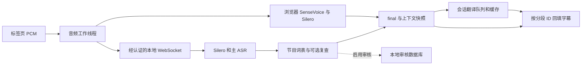

# 实时字幕架构

| 路径 | 基线 `7112fe9` | 开发分支 |
| --- | --- | --- |
| Audio | 16 kHz PCM，固定 Silero 参数，块末检查分段 | 逐个 Silero 帧消费完成分段，0.4/12 秒默认，有界工作线程与可配置边界重叠 |
| ASR | SenseVoice WASM，Python SenseVoice / Whisper Base | 默认 WASM，Python 增加 Parakeet、Turbo、Qwen，并按后端能力调度滚动预览 |
| Agent | 静态文本词表 | 按节目选择词包与核验术语，可选本机复查，审核和留出集验证独立运行 |
| Translation | 上一译文完成后推进上下文，本地只留最后一个任务 | 每个 final 固定会话快照。译文独立投递，支持可选多轮上下文和中英文译名 |
| Subtitle Delivery | 通用 WebSocket 队列，积压时可跳过事件 | 关键事件 FIFO，预览与统计合并，积压状态和会话隔离可观测 |
| Model Routing | 启动选 CPU 后端 | 启动选主后端及精度，加载失败可回退 CPU SenseVoice，选择性复查用独立推理槽 |

## 会话和资源

每次捕获由扩展生成独立会话 ID。WebSocket 内的 ASR 使用单调分段 ID。一条 final 有一个翻译状态，重复 ID 可幂等过滤。语言、上下文或 Agent 切换时清理旧快照及未完成任务。浏览器和演示页复用支持乱序回填的字幕时间线。

每个本地会话可排队 256 KiB PCM。服务器共享主推理槽，等待的 final 优先于新预览。复查最多额外加载一个模型，服务全局限制复查频率和截止时间。登录、输出、A/V 捕获和翻译分别有显式容量。详细断线与重连语义见开发文档。 [开发与协议](development.md)

模型权重保存在本机或浏览器缓存。节目标题仅用于本地匹配。DeepSeek 请求包含翻译所需文本和选中的上下文。审核数据库默认关闭，启用时只保存有限文本记录。可选说话人分离在录播模式运行并输出匿名 ID。 [本地服务与模型](local-service.md) · [翻译请求](translation.md) · [审核](agentic-asr.md)
